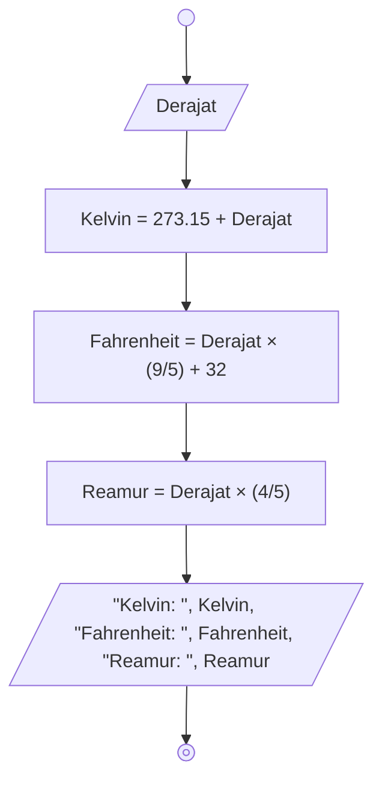

# Celcius-to-all Conversion Algorithm

## Descriptive

1. Mulai
2. Masukkan Derajat dalam skala celsius
3. Tambah Derajat dengan 273.15, simpan hasil pertambahan tersebut sebagai skala Kelvin
4. Kalikan Derajat celsius dengan pecahan 9/5, lalu tambahkan hasil perkalian tersebut dengan 32, simpan tambahan tersebut sebagai skala Fahrenheit
5. Kalikan derajat celsius dengan pecahan 4/5, simpan hasil perkalian tersebut sebagai skala Reamur
6. Tampilkan nilai-nilai yang sudah disimpan dengan format yang ditentukan
7. Selesai

## Flowchart



## Pseudo-code
```pseudo
DECLARE Derajat : REAL
DECLARE Kelvin : REAL
DECLARE Fahrenheit : REAL
DECLARE Reamur : REAL

INPUT Derajat

Kelvin <- Derajat + 273.5
Fahrenheit <- Derajat * (9/5) + 32
Reamur <- Derajat * (4/5)

OUTPUT "Kelvin: ", Kelvin, "Fahrenheit: ", Fahrenheit, "Reamur: ", Reamur
```