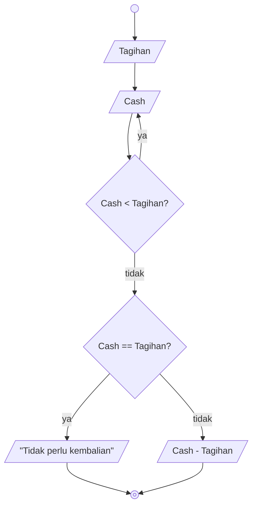

# Algorithm Implementation

Requirements:

1. Ada kontrol
2. Ada logika

## Menghitung berapa kembaliannya

### Deksriptif

1. Mulai
2. Masukkan nominal Tagihan
3. Masukkan nominal Cash
4. Jika nominal Tagihan lebih besar dari nominal Cash, masukkan kembali nominal Cash
5. Jika nominal Cash sama besarnya dengan Tagihan, tampilkan "Tidak perlu kembalian"
6. Jika nominal Cash lebih besar dari Tagihan, tampilkan pengurangan antara nominal Cash dengan Tagihan
7. Selesai

### Flowchart



### Pseudo-code

```pseudo
DECLARE Cash : INTEGER
DECLARE Tagihan : INTEGER

INPUT Tagihan
INPUT Cash

WHILE Cash < Tagihan
    INPUT Cash
ENDWHILE

IF Cash = Tagihan THEN
    OUTPUT "Tidak perlu kembalian"
ELSE
    OUTPUT Cash - Tagihan
ENDIF
```
